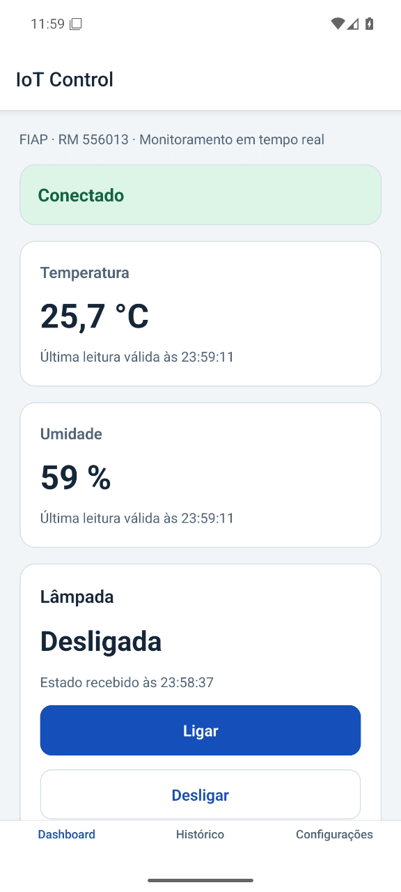
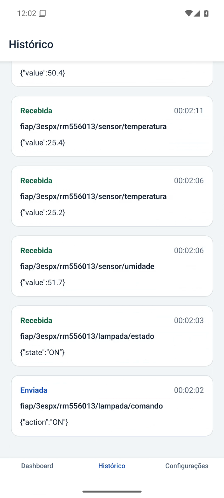
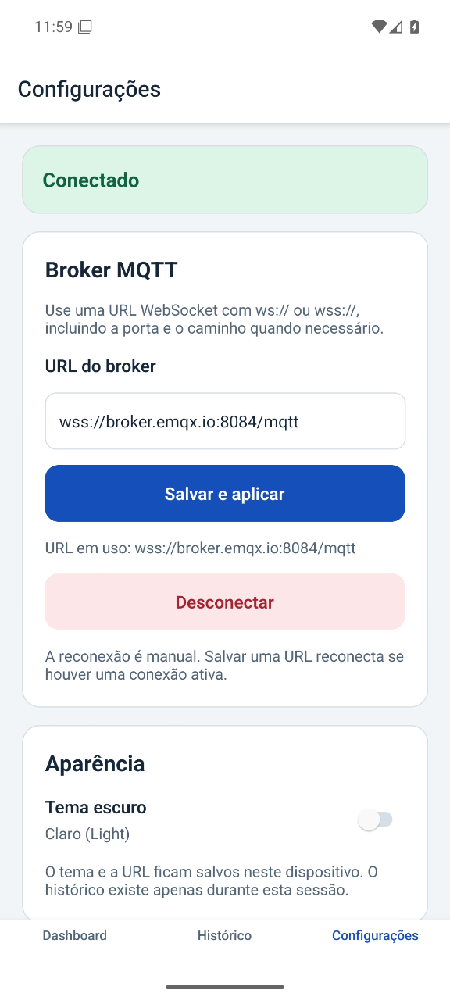
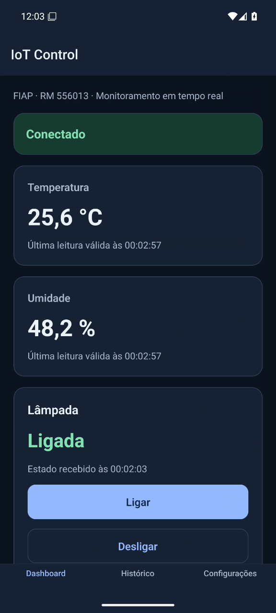
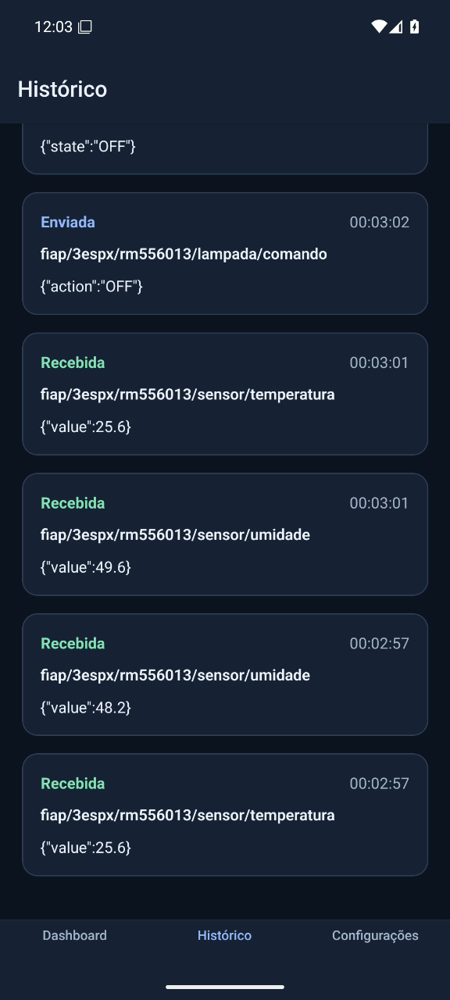
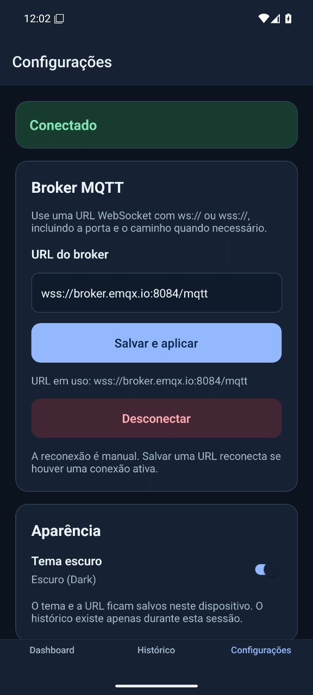

# IoT Control

**Integrante: Vinicius Silva Gardim — RM-556013**

Checkpoint 3 de Mobile — FIAP. App para acompanhar temperatura e umidade e controlar uma lâmpada simulada por MQTT. O objetivo é demonstrar a comunicação entre React Native e um dispositivo simulado, com confirmação do estado recebido.

## Tecnologias

Versões resolvidas em `package-lock.json`:

| Tecnologia | Versão |
| --- | --- |
| Expo | 58.0.19 |
| React Native | 0.88.0 |
| React | 19.3.0 |
| TypeScript | 6.0.3 |
| MQTT.js (`mqtt`) | 5.16.1 |
| AsyncStorage | 2.2.0 |
| React Navigation Native / Bottom Tabs | 7.5.1 / 7.21.0 |
| React DOM / React Native Web | 19.3.0 / 0.21.4 |
| Expo Metro Runtime | 58.0.15 |

Ambiente usado: **Node.js 22.19.0 e npm 10.9.3**. O simulador usa CommonJS.

## Pré-requisitos e execução

- Node.js e npm nas versões acima, internet e dependências do projeto.
- Android: Expo Go compatível com SDK 58 em um celular ou emulador já iniciado.
- iOS: Expo Go compatível em um iPhone ou macOS com Xcode para o simulador. Não há simulador iOS no Windows.
- Web: navegador com suporte a WebSocket.

Na pasta do projeto:

```sh
npm install
npx expo start
```

Pressione `a` para Android, `w` para Web ou use o QR Code no Expo Go. O celular precisa alcançar o servidor de desenvolvimento, normalmente pela mesma rede local. Em outro terminal, inicie **um único simulador**:

```sh
npm run simulator
```

O simulador inicia a lâmpada em `OFF`, publica o estado retido e envia sensores a cada 5 s. Encerre com `Ctrl+C`. O app carrega as preferências e tenta conectar; após uma perda de conexão, use **Reconectar**.

No emulador Windows testado, foi necessário iniciar o Metro com resolução IPv4, somente na sessão:

```powershell
$env:NODE_OPTIONS = '--dns-result-order=ipv4first'
npx expo start --localhost --android
```

O SDK local está em `%LOCALAPPDATA%\Android\Sdk`. O AVD `Pixel_IoT` usa Android 16/API 36. Para compilação nativa, Expo 58 exige API 37, instalada como `platforms;android-37.0`; a execução pelo Expo Go não exige compilar localmente.

### Outro broker

Defina `MQTT_URL` no simulador e informe a **mesma URL** em **Configurações → URL do broker → Salvar e aplicar** no app. Os dois precisam usar o mesmo broker e os mesmos tópicos.

PowerShell:

```powershell
$env:MQTT_URL = 'wss://broker.hivemq.com:8884/mqtt'
npm run simulator
```

Bash:

```bash
MQTT_URL='wss://broker.hivemq.com:8884/mqtt' npm run simulator
```

Para voltar ao padrão, encerre o simulador, remova a variável (`Remove-Item Env:MQTT_URL` no PowerShell ou `unset MQTT_URL` no bash, se exportada), restaure a URL padrão no app e inicie novamente.

## Broker e contrato MQTT

| Campo | Valor padrão |
| --- | --- |
| URL completa | `wss://broker.emqx.io:8084/mqtt` |
| Protocolo | WSS — MQTT sobre WebSocket seguro |
| Host / porta / caminho | `broker.emqx.io` / `8084` / `/mqtt` |
| Autenticação | Sem usuário e senha |
| Alternativa | `wss://broker.hivemq.com:8884/mqtt` |

**1883 é MQTT sobre TCP e não serve para conectar o app.** Nas Configurações, use a URL WebSocket completa, incluindo protocolo, porta e caminho. Referência: [portas do broker público EMQX](https://www.emqx.com/en/mqtt/public-mqtt5-broker).

| Tópico completo | Direção | Payload | Publicação |
| --- | --- | --- | --- |
| `fiap/3espx/rm556013/sensor/temperatura` | Simulador → app | `{"value":24.5}` | A cada 5 s; QoS 0; sem retenção |
| `fiap/3espx/rm556013/sensor/umidade` | Simulador → app | `{"value":58}` | A cada 5 s; QoS 0; sem retenção |
| `fiap/3espx/rm556013/lampada/comando` | App → simulador | `{"action":"ON"}` ou `{"action":"OFF"}` | QoS 1; `retain=false` |
| `fiap/3espx/rm556013/lampada/estado` | Simulador → app | `{"state":"ON"}` ou `{"state":"OFF"}` | QoS 1; `retain=true` |

Os IDs começam com `iotcontrol-app-rm556013-` e `iotcontrol-sim-rm556013-`, seguidos por sufixos para evitar colisões.

### Comando → simulador → confirmação

1. Conectado, o app publica `action` ao tocar em **Ligar** ou **Desligar**.
2. O simulador valida o JSON, atualiza o estado interno e publica `state` retido.
3. O app só altera a lâmpada quando recebe um `state` válido. O PUBACK do broker confirma a publicação, não o estado do dispositivo.

Antes do primeiro estado, a indicação é **Desconhecido**. Sem confirmação, o app mantém a indicação anterior e mostra que está aguardando o dispositivo. Novos assinantes recebem o último estado retido. Uma nova execução do simulador publica `OFF`; uma reconexão publica seu estado interno atual.

## Testar payloads inválidos

Com o app conectado, publique um valor de tipo incorreto. A leitura válida deve ser preservada e o Histórico deve marcar a mensagem como inválida. As flags foram conferidas em `npx mqtt pub --help`: `-h` host, `-p` porta, `-q` QoS, `-t` tópico e `-s` entrada padrão. Na pasta do projeto, `npx` usa o `mqtt` existente, sem adicionar dependência.

PowerShell:

```powershell
npx mqtt pub --help
'{"value":"invalido"}' | npx mqtt pub -h broker.emqx.io -p 1883 -q 1 -t fiap/3espx/rm556013/sensor/temperatura -s
```

Bash:

```bash
npx mqtt pub --help
printf '%s' '{"value":"invalido"}' | npx mqtt pub -h broker.emqx.io -p 1883 -q 1 -t fiap/3espx/rm556013/sensor/temperatura -s
```

Esse cliente de terminal usa TCP/1883 no mesmo broker; o app continua em WSS/8084. Ajuste host e porta do cliente se usar outro broker. Repita com `sensor/umidade` e `{"value":null}`, ou `lampada/estado` e `{"state":"INVALIDO"}`. Para testar o simulador, envie `{"action":"INVALIDO"}` a `fiap/3espx/rm556013/lampada/comando`: ele deve registrar e ignorar. **Não use `-r`**, para não reter mensagens inválidas.

## Telas e prints reais

| Tela | Função |
| --- | --- |
| Dashboard | Conexão, temperatura em °C, umidade em %, horário das últimas leituras válidas e lâmpada. Sem conexão, Ligar/Desligar ficam bloqueados com o motivo visível. Há reconexão manual e indicação de confirmação pendente. |
| Histórico | Até 10 mensagens, mais recentes primeiro, com direção, horário de recebimento/envio, tópico e payload bruto. Inválidas são sinalizadas. Comandos entram após o PUBACK. Não é persistido. |
| Configurações | Valida e salva URL `ws://` ou `wss://`, conecta/desconecta/reconecta e alterna o tema. Salvar URL com conexão ativa aplica a nova conexão; desconectado, exige Conectar. URL e tema são persistidos com AsyncStorage e carregados antes de conectar. |

Capturas da execução Android, sem edição. O botão de desenvolvimento foi ocultado em **menu do Expo Go → Tools button**, sem alterar o código do app.

| Tema | Dashboard | Histórico | Configurações |
| --- | --- | --- | --- |
| Claro |  |  |  |
| Escuro |  |  |  |

## Estrutura

| Caminho | Conteúdo |
| --- | --- |
| `App.tsx`, `index.ts`, `app.json` | Entrada e configuração do Expo |
| `src/components/`, `src/screens/` | Navegação, componentes e três telas |
| `src/services/` | MQTT, validação, contexto e preferências |
| `src/themes/`, `src/types/` | Cores, tipos e contrato dos tópicos |
| `simulator/index.js` | Dispositivo simulado em Node.js |
| `tests/`, `screenshots/`, `assets/` | Testes, capturas reais e recursos visuais |
| `package.json`, `package-lock.json` | Scripts, dependências e versões resolvidas |

## Verificações e plataformas

Validação Android em **26/10/2026**, Windows, perfil Pixel 6/AVD **Pixel_IoT**, **Android 16/API 36 x86_64**, WHPX e **Expo Go 58.0.5/Hermes**. Tela do dispositivo: 1080 × 2400; capturas do portal: 576 × 1280.

| Verificação | Resultado observado no Android |
| --- | --- |
| Sensores e ON/OFF | Leituras a cada 5 s; comandos e estados correspondentes conferidos na UI e no log do simulador |
| Desconexão intencional | Ligar e Desligar desabilitados; motivo “Conecte-se ao broker para enviar comandos” visível |
| URLs inválidas | `abc` e `http://exemplo.com` rejeitadas com erro compreensível, sem conectar ou substituir a URL salva |
| Broker inalcançável | `wss://localhost:9/mqtt` terminou em erro visível em cerca de 2,5 s, sem ficar em Conectando; EMQX restaurado |
| Navegação e reconexões | Três ciclos pelas três abas e de desconectar/conectar ou reconectar; três toques ON/OFF produziram exatamente três comandos, um por toque |
| Ausência de duplicatas na amostra | As 10 últimas leituras corresponderam uma a uma ao log do simulador após os ciclos; horários decrescentes no Histórico |
| Payloads inválidos | 15 mensagens nos três tópicos recebidos preservaram os valores e o estado válidos; erro indicado no Histórico |
| Rajada e limite | 24 mensagens em cerca de 4,8 s; exatamente as últimas 10 mantidas, com ordem, tópico e payload bruto conferidos |
| Sem simulador | OFF publicado, lâmpada permaneceu ligada aguardando por cerca de 22 s; só mudou após receber OFF ao reiniciar o simulador |
| Preferências e temas | Claro/escuro conferidos; URL EMQX e tema preservados após encerrar e reabrir o Expo Go |
| Testes locais | `npm test`: 17 aprovados; `npx tsc --noEmit`: sem erros |

**Web:** validado por Brasa em navegador real do portal Maestri no Windows, **Chromium 152.0.7977.130 / Electron 44.5.1**. Foram testados EMQX WSS, sensores atualizados, ON/OFF com confirmação sem mudança otimista, temas claro/escuro e navegação Dashboard/Configurações. Persistência/reload Web e outros navegadores não foram testados.

**iOS e APK independente não foram testados.** O simulador também teve retenção, comandos inválidos, novos assinantes e `MQTT_URL` no HiveMQ verificados por cliente separado. Os scripts e logs auxiliares ficaram fora do repositório, em `%TEMP%\iotcontrol-validation`.

## Limitações

- Broker público, sem autenticação nem privacidade dos tópicos: outras pessoas podem ler/publicar, inclusive alterar o estado retido. Não envie dados pessoais ou sensíveis.
- Disponibilidade e latência dependem da rede e do broker. Na preparação, envios simultâneos tiveram perdas observadas; com intervalo de 200 ms, as 39 mensagens de teste chegaram. A causa no serviço público não foi confirmada.
- Histórico limitado às 10 mensagens da sessão, sem persistência. Somente URL e tema são persistidos.
- Reconexão manual; comandos offline são recusados e não ficam em fila para envio posterior.
- Estado retido pode ser antigo e não comprova que o dispositivo está online. Sem simulador, a confirmação do dispositivo permanece pendente.
- Dispositivo simulado, sem sensores ou lâmpada físicos. Os resultados se limitam às plataformas e aos cenários registrados acima.
