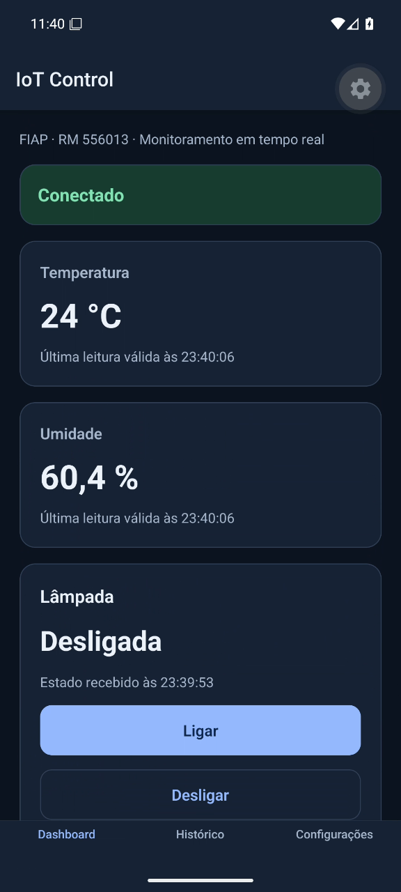

# IoT Control

**Integrante: Vinicius Silva Gardim — RM-556013**

Checkpoint 3 de Mobile — FIAP. Aplicativo para acompanhar temperatura e umidade e controlar uma lâmpada simulada usando MQTT. O objetivo é demonstrar comunicação entre um app React Native e um dispositivo simulado, com confirmação do estado recebido do dispositivo.

O app foi validado no Android com Expo Go, usando o simulador MQTT deste projeto. As capturas abaixo são da execução real no emulador.

## Tecnologias

Versões resolvidas em `package-lock.json`:

| Tecnologia | Versão |
| --- | --- |
| Expo | 58.0.19 |
| React Native | 0.88.0 |
| React | 19.3.0 |
| TypeScript | 6.0.3 |
| MQTT.js (`mqtt`) | 5.16.1 |
| AsyncStorage | 2.2.0 |
| React Navigation Native | 7.5.1 |
| React Navigation Bottom Tabs | 7.21.0 |

Ambiente usado: Node.js **22.19.0** e npm **10.9.3**. O simulador usa Node.js e CommonJS.

## Pré-requisitos

- Node.js 22.19.0 e npm, usados na validação deste projeto.
- Acesso à internet para instalar dependências e conectar ao broker público.
- Expo Go compatível com o SDK 58 em um celular ou emulador Android.
- Para iOS: Expo Go compatível em um iPhone ou macOS com Xcode para usar o simulador iOS. O simulador iOS não está disponível no Windows.

Para Android, inicie o emulador antes de abrir o app. No ambiente de desenvolvimento foi criado o AVD `Pixel_IoT`, com Android 16/API 36 e Google APIs x86_64. O SDK está em `%LOCALAPPDATA%\Android\Sdk`. A plataforma de compilação do Expo 58 é a API 37; neste ambiente ela foi instalada pelo identificador `platforms;android-37.0`. Usar Expo Go não exige compilar o app nativo localmente.

## Instalação e execução

Na pasta do projeto, instale as dependências e inicie o Expo:

```sh
npm install
npx expo start
```

No terminal do Expo, pressione `a` para abrir no Android ou leia o QR Code com o Expo Go compatível. O celular precisa alcançar o servidor de desenvolvimento; em uma rede local, mantenha o celular e o computador na mesma rede.

No emulador Windows usado nos testes, o Expo foi iniciado em modo local para evitar um problema de resolução IPv6 do Metro. Se precisar reproduzir esse ambiente, use somente nesse terminal:

```powershell
$env:NODE_OPTIONS = '--dns-result-order=ipv4first'
npx expo start --localhost --android
```

Em outro terminal, na mesma pasta, inicie um único simulador:

```sh
npm run simulator
```

O simulador começa com a lâmpada em `OFF`, publica esse estado retido e envia temperatura e umidade a cada 5 segundos. Use `Ctrl+C` para encerrá-lo.

O app carrega a URL salva nas Configurações e tenta conectar. Se a conexão cair, use **Reconectar**. No Dashboard, aguarde as leituras e o estado da lâmpada antes de testar **Ligar** e **Desligar**.

### Usar outro broker

Defina `MQTT_URL` antes de iniciar o simulador. No app, abra **Configurações**, preencha **URL do broker** com o mesmo endereço e toque em **Salvar e aplicar**. App e simulador precisam usar o mesmo broker e os mesmos tópicos.

PowerShell:

```powershell
$env:MQTT_URL = 'wss://broker.hivemq.com:8884/mqtt'
npm run simulator
```

Para voltar ao padrão nesse terminal:

```powershell
Remove-Item Env:MQTT_URL
npm run simulator
```

Bash:

```bash
MQTT_URL='wss://broker.hivemq.com:8884/mqtt' npm run simulator
```

Para voltar ao padrão, encerre o simulador e execute `npm run simulator` sem a variável. Se ela tiver sido exportada anteriormente, execute `unset MQTT_URL` antes.

## Broker MQTT

| Campo | Padrão |
| --- | --- |
| URL completa | `wss://broker.emqx.io:8084/mqtt` |
| Host | `broker.emqx.io` |
| Protocolo | WSS, MQTT sobre WebSocket seguro |
| Porta | `8084` |
| Caminho | `/mqtt` |
| Autenticação | Sem usuário e senha |
| Alternativa | `wss://broker.hivemq.com:8884/mqtt` |

A porta **1883 é MQTT sobre TCP e não serve como conexão do app**. Use a URL WebSocket completa nas Configurações, incluindo protocolo, porta e caminho. Um cliente MQTT de terminal pode usar TCP para publicar no mesmo broker, como no exemplo de teste abaixo.

Referência das portas e do broker público: [EMQX Public MQTT Broker](https://www.emqx.com/en/mqtt/public-mqtt5-broker).

### Tópicos e mensagens

Prefixo: `fiap/3espx/rm556013`.

| Tópico completo | Direção | Payload de exemplo | Publicação |
| --- | --- | --- | --- |
| `fiap/3espx/rm556013/sensor/temperatura` | Simulador → app | `{"value":24.5}` | A cada 5 s, QoS 0, sem retenção |
| `fiap/3espx/rm556013/sensor/umidade` | Simulador → app | `{"value":58}` | A cada 5 s, QoS 0, sem retenção |
| `fiap/3espx/rm556013/lampada/comando` | App → simulador | `{"action":"ON"}` ou `{"action":"OFF"}` | QoS 1, `retain=false` |
| `fiap/3espx/rm556013/lampada/estado` | Simulador → app | `{"state":"ON"}` ou `{"state":"OFF"}` | QoS 1, `retain=true` |

Os IDs de cliente têm os prefixos `iotcontrol-app-rm556013-` e `iotcontrol-sim-rm556013-`, com sufixos para evitar colisões.

### Comando e confirmação

1. O usuário toca em **Ligar** ou **Desligar** no app conectado.
2. O app publica `action` no tópico de comando, com QoS 1 e sem retenção.
3. O simulador valida o JSON, atualiza seu estado interno e publica `state` no tópico de estado, com retenção.
4. O app altera a indicação da lâmpada somente quando recebe um `state` válido. A confirmação do broker de que o comando foi publicado não confirma o estado do dispositivo.

Enquanto não chega o estado correspondente, o app indica que aguarda confirmação do dispositivo. Antes do primeiro estado válido, a lâmpada aparece como **Desconhecido**. Por ser retido, o último estado fica disponível a um novo assinante. Ao iniciar uma nova execução, o simulador publica seu estado inicial `OFF`; ao reconectar, publica seu estado interno atual.

## Testar mensagens inválidas

Com o app conectado, publique um JSON inválido ou um campo com tipo incorreto em um tópico recebido. Os sensores e a lâmpada devem preservar o último valor válido, e a mensagem deve aparecer como inválida no Histórico.

As opções abaixo foram conferidas em `npx mqtt pub --help`: `-h` host, `-p` porta, `-q` QoS, `-t` tópico e `-s` leitura do payload pela entrada padrão. Execute na pasta do projeto; `npx` usa o `mqtt` já instalado, sem adicionar uma dependência.

PowerShell:

```powershell
npx mqtt pub --help
'{"value":"invalido"}' | npx mqtt pub -h broker.emqx.io -p 1883 -q 1 -t fiap/3espx/rm556013/sensor/temperatura -s
```

Bash:

```bash
npx mqtt pub --help
printf '%s' '{"value":"invalido"}' | npx mqtt pub -h broker.emqx.io -p 1883 -q 1 -t fiap/3espx/rm556013/sensor/temperatura -s
```

Esse cliente de terminal usa TCP/1883 no EMQX; o app continua usando WSS/8084. Se o app e o simulador estiverem no broker alternativo, ajuste também o host e a porta do cliente de teste.

Repita com `sensor/umidade` e `{"value":null}`, ou com `lampada/estado` e `{"state":"INVALIDO"}`. Para testar o simulador, publique `{"action":"INVALIDO"}` em `fiap/3espx/rm556013/lampada/comando`: ele deve registrar o erro e manter o estado. Não use `-r` nesses testes, para não reter payloads inválidos.

## Telas

As três telas usam navegação por abas. URL e tema são carregados antes da primeira conexão ao broker.

### Dashboard

Exibe a conexão, temperatura em °C, umidade em %, horário das últimas leituras válidas e estado da lâmpada. As leituras ainda não recebidas aparecem sem valor; a lâmpada começa como desconhecida. Os botões **Ligar** e **Desligar** ficam desabilitados sem conexão ou durante o envio/salvamento. A tela informa quando aguarda a confirmação do dispositivo e oferece reconexão manual.


### Histórico

Lista até 10 mensagens, com as mais recentes primeiro. Cada item mostra direção, horário local do recebimento/envio, tópico e payload. Mensagens inválidas recebem uma indicação. Os comandos enviados entram após a confirmação da publicação pelo broker. O histórico fica apenas em memória.


### Configurações

Permite editar a URL do broker, salvar e aplicar, conectar, desconectar e reconectar. Aceita endereços `ws://` e `wss://`. Salvar uma nova URL com conexão ativa inicia a conexão com o novo endereço; desconectado, é necessário tocar em **Conectar**. O controle **Tema escuro** alterna a aparência. URL e tema ficam salvos no dispositivo com AsyncStorage.


O mesmo Dashboard em tema escuro:



## Estrutura de pastas

```text
IoT Control/
├── App.tsx
├── app.json
├── index.ts
├── assets/
├── simulator/
│   └── index.js
├── src/
│   ├── components/
│   ├── screens/
│   │   ├── DashboardScreen.tsx
│   │   ├── HistoryScreen.tsx
│   │   └── SettingsScreen.tsx
│   ├── services/
│   ├── themes/
│   └── types/
├── tests/
├── screenshots/
├── package.json
└── package-lock.json
```

`components/` contém a navegação e os elementos reutilizados nas telas. `services/` reúne conexão MQTT, validação de mensagens, contexto do app e preferências. `themes/` define as cores; `types/` define o contrato dos tópicos e os tipos de dados. `tests/` contém testes de mensagens, histórico, conexão MQTT e armazenamento. `screenshots/` contém capturas reais, sem mockups. Os scripts auxiliares de validação ficam fora do repositório.

## Verificações e plataformas

Validação integrada executada em **26/10/2026** no Windows, AVD **Pixel_IoT** com perfil Pixel 6, **Android 16/API 36 x86_64**, aceleração WHPX e tela 1080 × 2400. O app executou no **Expo Go 58.0.5 com Hermes**, conectado ao EMQX por WSS.

| Verificação | Resultado observado |
| --- | --- |
| Temperatura e umidade | Leituras do simulador exibidas com unidade e horário; novas publicações a cada 5 s |
| ON/OFF | Comando recebido pelo simulador, estado publicado e indicação da lâmpada atualizada após a confirmação |
| Payloads inválidos | 15 mensagens nos três tópicos de recebimento; temperatura de 28,8 °C, umidade de 52,7% e lâmpada ligada preservadas, com indicação de mensagem inválida no Histórico |
| Histórico após rajada | 24 mensagens publicadas em cerca de 4,8 s; ficaram exatamente as últimas 10, mais recentes primeiro, com tópico, horário e payload bruto |
| Comando sem simulador | OFF publicado e confirmado pelo broker; lâmpada permaneceu ligada, aguardando confirmação do dispositivo por cerca de 22 s. Só mudou ao receber OFF após reiniciar o simulador |
| Reconexão manual | Após perda de conexão, o app preservou as leituras e exibiu Reconectar. A conexão e a entrega do estado retido voltaram após o toque |
| Temas e preferências | Temas claro/escuro conferidos; URL EMQX e tema claro preservados após encerrar e reabrir o Expo Go |
| Testes locais | `npm test`: 17 testes aprovados; `npx tsc --noEmit`: sem erros |

Evidências adicionais: [mensagens inválidas](screenshots/invalidos.png), [fim do histórico com a décima entrada](screenshots/historico-final.png) e [comando sem simulador, ainda sem confirmação](screenshots/sem-simulador.png).

O simulador também foi validado com um cliente MQTT separado: estado inicial retido, ON/OFF, novos assinantes, comandos inválidos e intervalo dos sensores. A variável `MQTT_URL` foi verificada com conexão WSS ao HiveMQ. O exemplo de `npx mqtt pub` por TCP/1883 foi recebido por um assinante WSS/8084 no mesmo broker, em tópico isolado.

Durante a preparação da rajada no broker público, envios simultâneos tiveram publicações confirmadas que não chegaram ao assinante. Os scripts auxiliares passaram a espaçar os envios em 200 ms; nesse teste, todas as 39 mensagens chegaram. A causa da limitação no serviço público não foi confirmada.

**iOS e Web não foram testados.** Não foi produzido um APK independente; a execução Android validada foi pelo Expo Go.

## Limitações

- O broker é público, sem autenticação e sem privacidade dos tópicos. Não envie dados pessoais ou sensíveis. Outras pessoas podem ler e publicar nesses tópicos, inclusive alterar o estado retido.
- A disponibilidade e a latência dependem da internet e do broker público.
- O histórico mantém apenas as 10 últimas mensagens da sessão e não é persistido. URL e tema são persistidos.
- A reconexão do app é manual. Comandos sem conexão são recusados e não ficam em uma fila para envio posterior.
- Sem o simulador, o broker pode entregar um estado retido antigo; esse estado não comprova que o dispositivo está online. O app aguarda uma mensagem de estado para confirmar cada comando.
- O dispositivo é simulado. Não há integração com sensores ou lâmpada físicos.
- Os resultados acima se limitam ao ambiente Android registrado; não comprovam execução nas plataformas não testadas.
